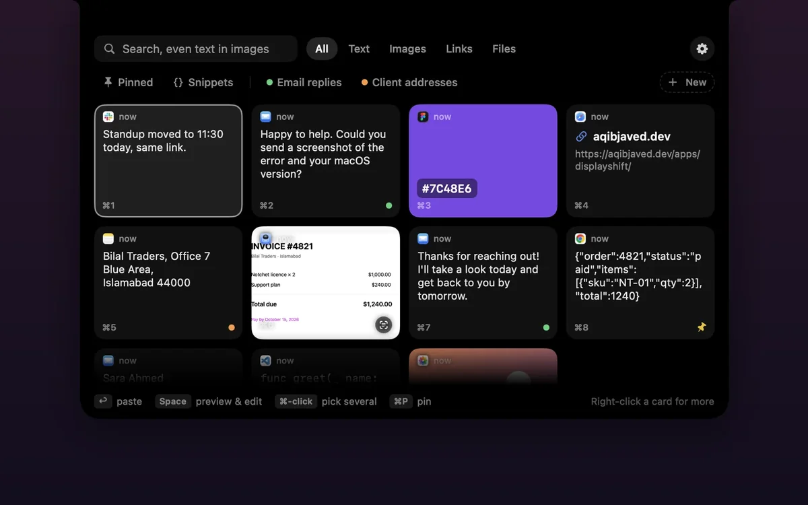
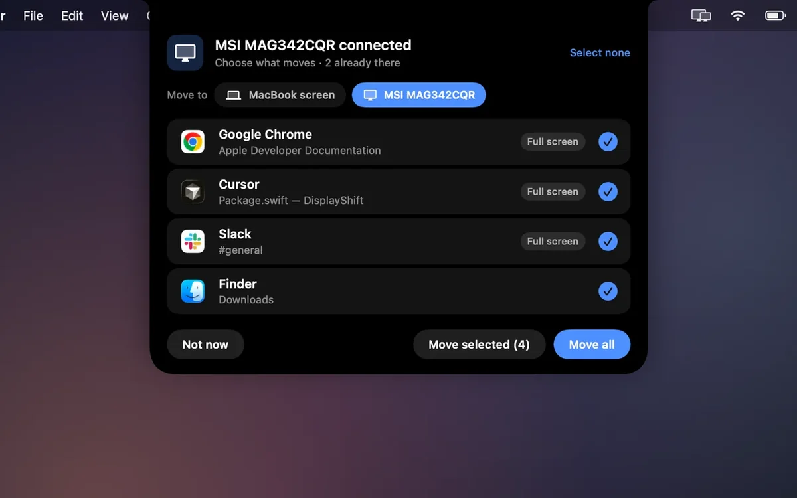
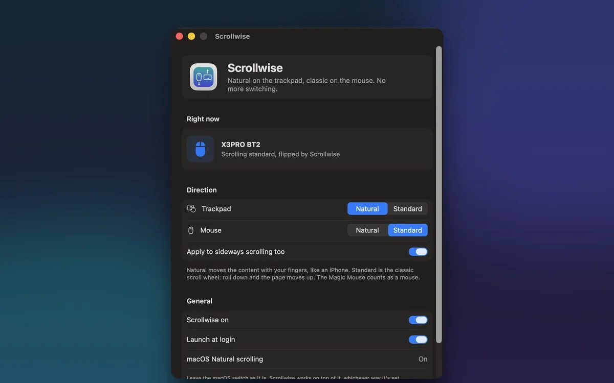

# Aqib Javed

Software engineer in Karachi, building AI products end to end. Mobile and web apps, the backend behind them, payments, and the AI features that make them worth opening, from the first screen to the App Store and Play Store release.

**[aqibjaved.dev](https://aqibjaved.dev)** · [LinkedIn](https://linkedin.com/in/aqib-javed-494ba8285) · [Fiverr](https://www.fiverr.com/hazproductions) · aqib199800@gmail.com

## Things I've shipped

<table>
<tr>
<td width="50%" valign="top">

<b><a href="https://aqibjaved.dev/work/trackermax/">TrackerMax</a></b>, builder and owner 
A workout tracker with a real watch app on both platforms: native SwiftUI on watchOS and Jetpack Compose on Wear OS, synced with the phone app. <a href="https://apps.apple.com/app/id6737291931">App Store</a>
</td>
<td width="50%" valign="top">

<b><a href="https://aqibjaved.dev/work/spectoria/">Spectoria</a></b>, co-founder and lead engineer 
One prompt, one credit ledger, whichever AI video model fits. <a href="https://spectoria.cc">spectoria.cc</a>
</td>
</tr>
</table>

Also: [Art2Life](https://aqibjaved.dev/work/art2life/) (34 AI photo and video modes behind one credit balance), [Affili-Fit](https://aqibjaved.dev/work/affili-fit/) (meal plans, workouts and the grocery run in one app) and [Jobblish](https://aqibjaved.dev/work/jobblish/) (a freelance marketplace where the chat feels instant). Case studies with the real screenshots are on [aqibjaved.dev/work](https://aqibjaved.dev/work/).

## Mac apps

Menu bar apps I built for my own desk and now sell to others. Native Swift and SwiftUI, notarized by Apple, no accounts, and they keep themselves up to date.

<table>
<tr>
<td width="33%" valign="top">

 <b><a href="https://aqibjaved.dev/apps/notchet/">Notchet</a></b> 
Clipboard history that drops out of the notch. Pick a card and it pastes where you were, or drag it into any app. 
7-day free trial, then $2.99 once
</td>
<td width="33%" valign="top">

 <b><a href="https://aqibjaved.dev/apps/displayshift/">DisplayShift</a></b> 
Plug in a monitor and choose which windows move over, full screen apps too. Tiles up to four apps and puts everything back after sleep. 
7-day free trial, then $2.99 once
</td>
<td width="33%" valign="top">

 <b><a href="https://aqibjaved.dev/apps/scrollwise/">Scrollwise</a></b> 
Natural scrolling on the trackpad, classic on any mouse, Magic Mouse included. No more flipping the macOS switch. 
Free
</td>
</tr>
</table>

## Open source

<table>
<tr>
<td width="50%" valign="top">

</td>
<td width="50%" valign="top">
 <b><a href="https://github.com/AqibJavedZeepalm/stackyard">Stackyard</a></b> 
Every SDK and toolchain on your machine (Flutter, Node.js, Android SDK, Xcode simulators, Java, Python, .NET), which projects use each version, and what's safe to remove. Fixes broken setups in one click. 
Free and open source (MIT), Windows and macOS
</td>
</tr>
</table>

## What I work with

- **AI:** Gemini, OpenAI and Claude APIs, AI agents and chatbots, voice agents, AI video and image pipelines
- **Apps:** iOS and Android, watchOS and Wear OS, web, and native macOS in Swift, SwiftUI and AppKit
- **Backend:** Node.js and TypeScript, Firebase and Cloud Functions, REST and realtime APIs
- **Shipping:** Stripe and RevenueCat payments, licence keys, CI/CD, App Store and Play Store releases, notarized Mac apps that update themselves

## Work with me

Available for mobile and AI work, remote. The quickest way to reach me is the [contact page](https://aqibjaved.dev/contact/) or email.
